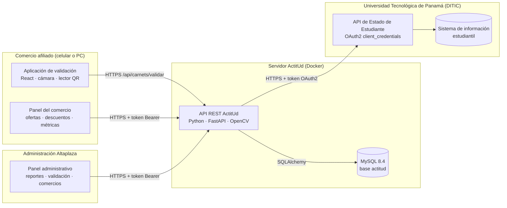
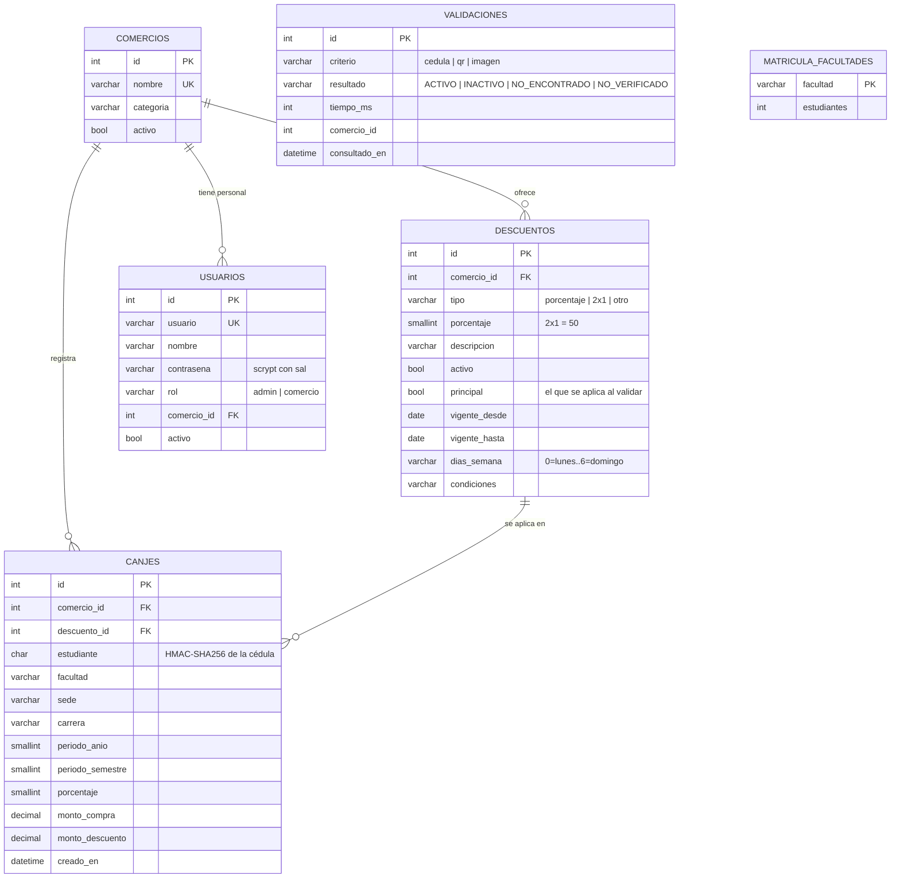
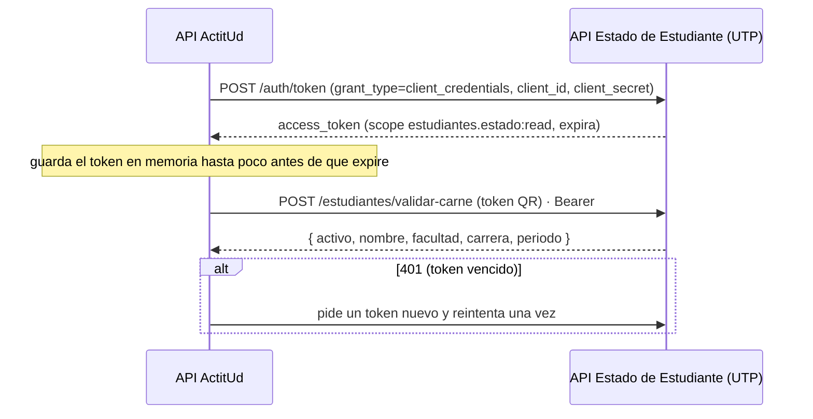
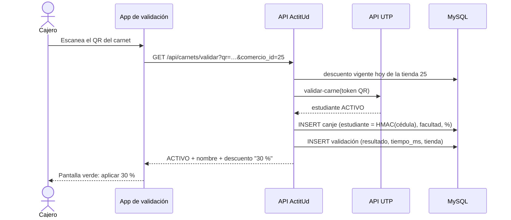

# Arquitectura tecnológica y lineamientos del sistema ActitUd

> **Objetivo específico 3 del anteproyecto:** *Diseñar la arquitectura tecnológica del sistema de validación QR, definiendo los componentes, modelos de datos, flujos de autenticación y lineamientos de seguridad y privacidad que servirían de base para una futura integración con el sistema de información estudiantil de la UTP.*
>
> Corresponde al Capítulo III (Diseño del Sistema y Metodología) y a las actividades 3 y 4 del cronograma. Todo lo descrito aquí está implementado en el repositorio y cubierto por pruebas automáticas (`api/tests`, 93 pruebas).

---

## 1. Descripción de la solución

ActitUd reemplaza la tarjeta física del programa por el **código QR del carnet digital de la UTP**.

1. El personal del comercio escanea el QR con la aplicación web desde su celular.
2. La API consulta en tiempo real a la API de Estado de Estudiante de la UTP.
3. Si el estudiante está **activo** (matriculado en el periodo vigente), la API determina el descuento que corresponde a ese comercio ese día y lo registra.
4. Si está **inactivo** o no existe, se rechaza.
5. Si la UTP no responde, se informa "no se pudo verificar". Nunca se informa como "inactivo".

## 2. Componentes



| Componente | Tecnología | Responsabilidad | Carpeta |
|---|---|---|---|
| Aplicación de validación | React 19 + TypeScript + Vite, lector QR en el navegador | Escanear el QR, escribir la cédula o subir una foto; mostrar activo, inactivo o no verificado y el descuento a aplicar | `frontend/` |
| Panel administrativo | El mismo frontend (ruta `#/panel`) | Admin: uso del programa, reporte de validación, gestión de comercios. Comercio: sus ofertas, configuración del descuento y sus métricas | `frontend/src/components/panel` |
| API REST ActitUd | Python 3.12, FastAPI, SQLAlchemy, OpenCV, qrcode | Validación, reglas de descuento, sesiones, reportes | `api/` |
| Base de datos | MySQL 8.4 | Comercios, descuentos, canjes, bitácora de validaciones, usuarios | `db/`, `api/app/db.py` |
| API UTP (simulada) | Python, mismo contrato OpenAPI que la API real | Responder el estado académico con datos ficticios | `mock-utp/`, `api-estudiante-mock/openapi.yaml` |
| Documentación de la API | OpenAPI automático en `/docs` y colección Postman | Pruebas y documentación de los endpoints | `postman/` |
| Control de versiones | Git y GitHub (ramas `main` y `dev_juan`) | Respaldo e historial; GitHub Pages publica la versión de demostración | `.github/workflows` |

**Decisión de diseño:** la API de ActitUd **no tiene copia de los estudiantes**. Siempre los consulta a la API de la UTP, aunque en el prototipo esa API sea simulada. Así la integración real solo requiere cambiar `UTP_API_URL` y las credenciales.

## 3. Modelo de datos



Los "perfiles estudiantiles simulados" que pide el anteproyecto viven en una base aparte (`utp_mock`). Solo la lee la API UTP simulada, igual que la base real de la UTP solo la lee la DITIC.

**Reglas del negocio implementadas** (tomadas del arte oficial ACTITUD, Anexo D):

| Regla | Implementación |
|---|---|
| Solo estudiantes activos | Activo = matriculado en el periodo vigente, según la UTP. Inactivo o no encontrado: no hay descuento |
| Cada comercio tiene su descuento | Se aplica la oferta **principal** del comercio si es vigente hoy; si no, la primera oferta vigente hoy |
| "Válido de lunes a viernes" o "de lunes a jueves" | Campo `dias_semana` por oferta |
| "Válidos hasta el 31 de diciembre de 2026" | Campos `vigente_desde` y `vigente_hasta` |
| Restricciones (precio regular, no acumulable, etc.) | Campo `condiciones`, visible para el comercio |
| "No son transferibles" | Validación en tiempo real con identidad (nombre del titular en pantalla) y alerta de "mismo carnet en dos tiendas en menos de 10 minutos" |
| Un escaneo repetido no es otro descuento | El mismo estudiante en la misma tienda dentro de 10 minutos devuelve el canje existente |
| Una oferta usada no se borra | Si tiene canjes solo se puede desactivar, para conservar el historial |

## 4. Interfaces (API REST)

| Método y ruta | Quién | Propósito |
|---|---|---|
| `GET /api/carnets/validar?qr=…&comercio_id=…` (o `cedula=`) | App de validación | Valida y, si el estudiante está activo, registra el descuento |
| `POST /api/carnets/validar-imagen` | App de validación | Lee el QR de una foto con OpenCV y valida |
| `GET /api/comercios` | App de validación | Tiendas con ofertas vigentes hoy |
| `POST /api/auth/login` · `GET /api/auth/sesion` | Panel | Inicio de sesión (admin o comercio) y token Bearer |
| `GET /api/panel/comercios/{id}` | Comercio (su tienda) o admin | Tienda, ofertas y usuarios |
| `POST`, `PUT` y `DELETE /api/panel/comercios/{id}/descuentos[/{d}]` | Comercio (su tienda) o admin | Gestionar ofertas y configurar descuentos |
| `GET /api/panel/comercios/{id}/metricas?dias=` | Comercio (su tienda) o admin | Métricas básicas de la tienda |
| `GET`, `POST` y `PUT /api/admin/comercios[/{id}]` | Admin | Afiliar, editar, activar y desactivar tiendas |
| `POST /api/admin/comercios/{id}/usuarios` · `PATCH /api/admin/usuarios/{id}` | Admin | Usuarios de cada tienda |
| `GET /api/reportes?dias=` | Admin | Uso del programa |
| `GET /api/reportes/validacion?dias=` | Admin | Tasa de validaciones exitosas y tiempos de respuesta |
| `GET /api/salud` | Monitoreo | Estado de la API y de la base de datos |

La documentación interactiva está en `http://localhost:4000/docs`. Las pruebas están en `postman/ActitUd.postman_collection.json`.

## 5. Flujos de autenticación

### 5.1 ActitUd → UTP (servicio a servicio, OAuth2 client credentials)



- Las credenciales (`UTP_CLIENT_ID` y `UTP_CLIENT_SECRET`) solo están en variables de entorno del servidor, nunca en el frontend.
- El tiempo de espera es de **5 s**. Un error 500, 503 o 429, o un tiempo agotado, se traduce en **"no se pudo verificar"** (503), nunca en "inactivo".
- Cupo de consultas a la UTP: 55 por minuto. Caché opcional de respuestas (30 s; desactivada con el mock).

### 5.2 Validación en el punto de venta



### 5.3 Panel (personas: administración y comercios)

```mermaid
sequenceDiagram
  actor U as Usuario (admin o comercio)
  participant P as Panel
  participant API as API ActitUd
  U->>P: usuario + contraseña
  P->>API: POST /api/auth/login
  API->>API: verifica scrypt (tiempo constante; huella falsa si el usuario no existe)
  API-->>P: token = base64(sub, rol, exp) + firma HMAC-SHA256 · 8 h
  P->>API: GET /api/panel/comercios/7 · Authorization: Bearer token
  API->>API: firma y vencimiento válidos · usuario activo · rol admin o comercio_id = 7
  API-->>P: 200 datos · o 401 (sesión vencida) · o 403 (otra tienda)
```

**Roles y permisos**

| Acción | Admin | Comercio |
|---|---|---|
| Ver y gestionar las ofertas de su tienda | ✔ (de cualquier tienda) | ✔ (solo la suya) |
| Ver las métricas de su tienda | ✔ | ✔ (sin alertas por estudiante ni comparación con otras tiendas) |
| Reportes del programa y reporte de validación | ✔ | ✘ (403) |
| Afiliar tiendas y crear o desactivar usuarios | ✔ | ✘ (403) |
| Validar desde el escáner | ✔ | ✔ (la tienda queda fijada por la sesión) |

## 6. Lineamientos de seguridad

| # | Lineamiento | Implementación en el prototipo |
|---|---|---|
| S1 | Mínimo privilegio | Roles admin y comercio; un comercio solo accede a su `comercio_id` (403 en otro caso) |
| S2 | Contraseñas nunca en claro | scrypt (n = 2¹⁴, r = 8, p = 1) con sal aleatoria por usuario; comparación en tiempo constante |
| S3 | Sesiones firmadas y con vencimiento | Token HMAC-SHA256 con expiración de 8 h; un usuario desactivado pierde la sesión al instante |
| S4 | No revelar si un usuario existe | El login responde igual y tarda lo mismo con un usuario inexistente o una contraseña errónea |
| S5 | Límite de intentos | 10 inicios de sesión por minuto por IP; 30 validaciones por minuto por IP (429 con `Retry-After`) |
| S6 | Secretos fuera del código | `CLAVE_SESION`, `CLAVE_ANONIMIZACION`, credenciales UTP y de MySQL en variables de entorno; los valores por defecto son solo para desarrollo |
| S7 | Validación de entradas | Esquemas Pydantic (formato de cédula, longitudes, rangos 1–100 %, días 0–6, vigencia coherente); imágenes de 5 MB como máximo |
| S8 | Sin caché de respuestas | Encabezado `Cache-Control: no-store` en todas las respuestas |
| S9 | CORS restringido | Solo el origen configurado (`CORS_ORIGIN`) |
| S10 | Disponibilidad honesta | Si la UTP falla, se responde "no se pudo verificar"; nunca se niega ni se concede un descuento por error |
| S11 | Transporte cifrado | En producción, solo HTTPS (TLS) entre navegador y API y entre API y UTP |
| S12 | Pruebas automáticas | 93 pruebas: permisos, sesiones, reglas de descuento, privacidad de la bitácora |

## 7. Lineamientos de privacidad y protección de datos

Marco de referencia: **Ley 81 de 26 de marzo de 2019 sobre protección de datos personales** de la República de Panamá y su reglamentación (Decreto Ejecutivo 285 de 2021). Principios aplicados: licitud, finalidad, proporcionalidad o minimización, seguridad, confidencialidad y transparencia.

| # | Lineamiento | Implementación |
|---|---|---|
| P1 | Minimización | La API **no guarda la cédula, el nombre ni el contenido del QR**. La bitácora de validaciones guarda solo el método, el resultado, el tiempo, la tienda y la hora |
| P2 | Seudonimización | Cada canje identifica al estudiante con un **HMAC-SHA256 de la cédula** con clave secreta. Permite contar estudiantes únicos y recurrencia sin poder revertirlo sin la clave |
| P3 | Anonimato en reportes (k-anonimato) | Los grupos con menos de **5 estudiantes** (por facultad o carrera) se agrupan en "Otros" para que nadie pueda ser identificado |
| P4 | Finalidad | Los datos se usan solo para validar el beneficio y medir el programa; no se venden ni se ceden |
| P5 | Separación de fuentes | Los datos académicos permanecen en la UTP; ActitUd los consulta en el momento y no los replica |
| P6 | Registros sin datos personales | Los registros del servidor omiten la cadena de consulta (donde van la cédula y el QR); la librería HTTP no registra URLs |
| P7 | Lo que ve cada rol | El comercio ve métricas agregadas de su tienda, sin alertas por estudiante; el nombre del estudiante solo aparece en la pantalla del cajero durante la validación |
| P8 | Transparencia | Aviso al estudiante (en la tienda o en el carnet digital) de que la validación consulta a la UTP solo si está activo |
| P9 | Formalización | Una implementación real requiere un convenio UTP–Altaplaza que defina responsable y encargado del tratamiento, finalidad, plazo de conservación de los canjes y procedimiento ante incidentes |

## 8. Base para la integración real con la UTP (DITIC)

1. **Convenio** UTP–Altaplaza (lineamiento P9) y emisión de credenciales OAuth2 propias para ActitUd con el scope `estudiantes.estado:read`.
2. **Configuración:** cambiar `UTP_API_URL`, `UTP_CLIENT_ID` y `UTP_CLIENT_SECRET`, sin cambios de código, porque se respeta el contrato `api-estudiante-mock/openapi.yaml`.
3. **Despliegue** en un servidor con HTTPS. Generar claves nuevas (`CLAVE_SESION` y `CLAVE_ANONIMIZACION`) y cambiar la contraseña del administrador inicial.
4. **Piloto** con algunos comercios y el reporte de validación activo para medir tiempos reales contra la UTP.

## 9. Proceso metodológico de desarrollo

Desarrollo iterativo en las 6 semanas del cronograma del anteproyecto: levantamiento → diseño (este documento) → desarrollo por módulos (escáner y consulta, luego panel) → integración y pruebas → pruebas con usuarios → análisis. Cada cambio se versiona en GitHub con pruebas automáticas.

**Recursos:** un desarrollador (el autor), el asesor (Prof. Kaiser Williams) y los contactos de Altaplaza Mall y de la DITIC.
